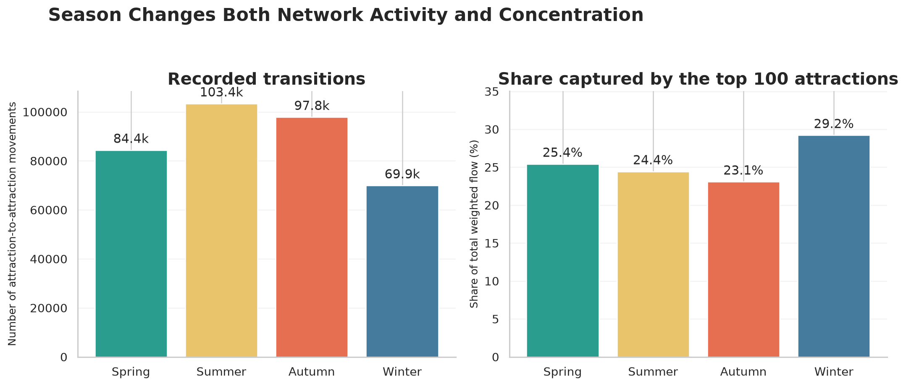

# Seasonal Structure of Tourist Mobility Across China

**Author:** Zihao Shao (`mc65176`)  
**Status:** Completed  
**Research question:** *How do tourist mobility patterns among Chinese attractions vary by season?*

## Project overview

This project studies a nationwide network of consecutive attraction visits derived from public Qunar travel blogs. Attractions are nodes, movements from one attraction to the next are directed edges, and edge weights count recorded transitions. I compare the four seasonal networks and reconstruct a full observed network by summing matching seasonal edges.

The analysis covers **22,621 attractions**, **126,962 directed routes**, and **355,527 recorded attraction-to-attraction transitions**. These values describe the source's travel-blog records; they are not official tourist counts.

## Key findings

- **Summer had the highest observed activity:** 103,369 transitions, 47.9% more than winter's 69,910.
- **Winter travel was more concentrated:** the top 100 attractions accounted for 29.2% of winter weighted flow, compared with 23.1% in autumn.
- **Lijiang Ancient City was the strongest hub:** its reconstructed annual weighted flow was 6,476, ahead of Dali Ancient City (4,531).
- **Regional clusters were prominent:** high-flow attractions were concentrated around Lijiang-Dali, Xiamen, Chengdu, the Yangtze River Delta, Beijing-Xi'an, and Sanya.
- Across all seasons, the top 100 attractions represented 23.9% of full-network weighted flow.

## Visual results


The leading hubs are mainly historic districts, scenic areas, and well-known urban landmarks. Weighted flow is the sum of incoming and outgoing recorded transitions.



Summer and autumn contain more movement, while winter has a smaller but more concentrated network. This suggests that off-season itineraries in the blog sample focus more heavily on a limited set of established destinations.


The coordinate plot uses the source's GCJ-02 coordinates and deliberately avoids combining them with a WGS-84 basemap.

## Method

1. Download the four seasonal node and edge tables from Figshare.
2. Validate each downloaded file against its published MD5 checksum.
3. Combine node metadata and remove duplicate attraction IDs.
4. Reconstruct the full network by grouping the four seasonal edge tables by `Source` and `Target` and summing `Weight`.
5. Calculate each attraction's weighted flow as incoming weight plus outgoing weight.
6. Compare seasons using transition volume, active attractions, observed routes, and the weighted-flow share of the top 10 and top 100 attractions.
7. Export reproducible result tables and publication-ready visualizations.

## Repository structure

```text
data-science-project/
|-- data/
|   |-- README.md
|   `-- raw/                 # downloaded CSV files; ignored by Git
|-- figures/                 # three final visualizations
|-- results/                 # processed CSV tables and findings
|-- src/
|   |-- download_data.py
|   `-- analyze_tourism_network.py
|-- AI_USAGE.md
|-- LICENSE
|-- README.md
`-- requirements.txt
```

## Reproduce the analysis

Python 3.10 or newer is recommended.

```bash
python -m venv .venv
# Windows: .venv\Scripts\activate
# macOS/Linux: source .venv/bin/activate
pip install -r requirements.txt
python src/download_data.py
python src/analyze_tourism_network.py
```

The analysis recreates all files in `results/` and `figures/`.

## Data source and permission

Zheng, Y., Wang, J., Zhang, Y., Mou, N., & Liu, Y. (2025). *A dataset of tourist mobility networks across China derived from online travel blogs*. Figshare. <https://doi.org/10.6084/m9.figshare.30184726.v1>

The source dataset is licensed under [CC BY 4.0](https://creativecommons.org/licenses/by/4.0/), permitting sharing and adaptation with attribution. The project code is available under the MIT License. Raw source CSV files are not redistributed in this repository; the download script retrieves the authoritative version directly from Figshare.

## Limitations

- Travel-blog authors are not representative of all tourists in China.
- Popular and highly shareable destinations are likely overrepresented.
- The source reflects approximately 2011-2021 and should not be interpreted as current demand.
- Edge weights represent recorded consecutive visits, not official passenger or visitor counts.
- Seasonal differences are descriptive and do not establish causality.
- Coordinates use GCJ-02 and require care when combined with other geographic layers.

## Next steps

Future work could add network centrality measures, compare travel-partner groups, normalize seasonal flow by the number of source blogs, and investigate whether climate or transport accessibility explains the observed regional patterns.
